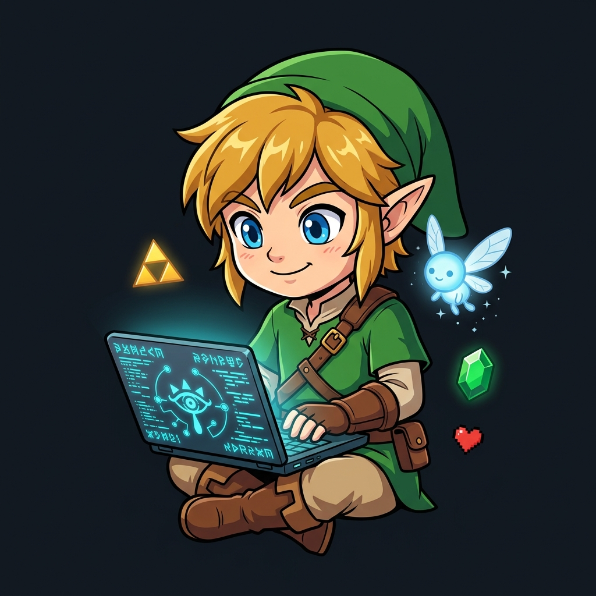

  

  
  
  
  

 

<!-- ==================== HERO / SHEIKAH SLATE ==================== -->
<table>
  <tr>
    <td width="66%" valign="top">
      <h3><code>HEY! LISTEN!</code> — Player Bio</h3>
      

        Hi! I'm <strong>Mateo Garzón Rubio</strong> (<code>WesitosFsa</code>), a
        <strong>Software Development Technologist</strong> graduated from
        <em>Escuela Politécnica Nacional (EPN)</em> in Ecuador 🇪🇨.
      

      

        I combine <strong>Full-Stack Web &amp; Mobile Development</strong> (Java/Spring Boot, React, Node.js, PHP, Flutter)
        with hands-on <strong>Infrastructure &amp; Systems Support</strong> (TCP/IP networking, Windows Server, Rocky Linux, Docker, AWS).
      

      <ul>
        <li>-<strong>Current Quest:</strong> Systems Support Analyst @ <em>Seit Ingenieros</em></li>
        <li>-<strong>Playstyle:</strong> TDD, Pair Programming, CI/CD &amp; Scrum/Agile</li>
        <li>-<strong>Side Passion:</strong> Game Dev in Godot &amp; Augmented Reality apps</li>
        <li>-<strong>Base Camp:</strong> <a href="https://wesitosfsa.github.io">wesitosfsa.github.io</a></li>
      </ul>
    </td>
    <td width="34%" align="center" valign="middle">
      
       
      <i>"It's dangerous to go alone! Take clean code."</i>
    </td>
  </tr>
</table>

 

<!-- ==================== INVENTORY / TECH STACK ==================== -->
###  Adventure Inventory (Tech Stack)

> Every tool equipped in my pouch—from backend blades to cloud shields.

####  Main Weapons — Languages &amp; Frameworks

  
  
  
  
  
  
  
  
  
  
  

####  Gear &amp; Arcane Arts — Mobile &amp; Game Dev

  
  
  
  
  

####  Potions — Databases &amp; Storage

  
  
  
  

####  Hyrule Infrastructure — Cloud, DevOps &amp; Systems

  
  
  
  
  
  
  
  
  

 

<!-- ==================== QUEST LOG ==================== -->
###  Quest Log — Featured Projects &amp; Experience

| Quest | Role &amp; Stack | Highlights |
| :--- | :--- | :--- |
|  **Game Jam Plus — 10th Edition** *(2025–2026)* | `Jammer` · `Godot (GDScript)` | Built a game prototype under tight deadlines; **selected for the Incubation Stage** focused on debugging &amp; performance optimization. |
|  **Cochasquí Archaeological Park App** *(2025)* | `Thesis Project` · `Flutter` `AR` `SQLite` `Supabase` | Mobile app featuring interactive maps &amp; **Augmented Reality (AR)** with local SQLite + Supabase offline/online sync. |
|  **Seit Ingenieros** *(Apr 2026 – Present)* | `Systems Support Analyst` · `TCP/IP` `Windows Server` `Cloud` | Network administration, virtualization, cloud optimization, backup &amp; disaster recovery, and remote end-user support. |
|  **VirtualWolf** *(Aug 2024 – Oct 2024)* | `Intern – Web Developer` · `PHP` `Git` | Developed web features in PHP, resolved production bugs via log analysis, and collaborated with Git-based workflows. |

🏅 <strong>Unlocked Achievements &amp; Certifications</strong> (click to expand)

 

-  **CCTV Certified General Security Associate (CGSA)** — *Hikvision* (Jul 2026 – Jul 2031)
-  **Game Jam Plus 10th Edition** — *Jammer Certificate &amp; Incubation Stage Certificate* (2025–2026)
-  **Beginner Programming Training G3** — *ONE (Oracle Next Education)*
-  **Personal Development Training G3** — *ONE (Oracle Next Education)*
-  **Associate Degree in Software Development (Tecnología Superior)** — *Escuela Politécnica Nacional* (Apr 2022 – Nov 2025)

 

<!-- ==================== SAVE POINT / CONTACT ==================== -->
###  Save Point — Connect With Me

  
  
  
  
  

 

<!-- ==================== HYRULE CONTRIBUTION SNAKE ==================== -->
###  Hyrule Activity Trail

  

